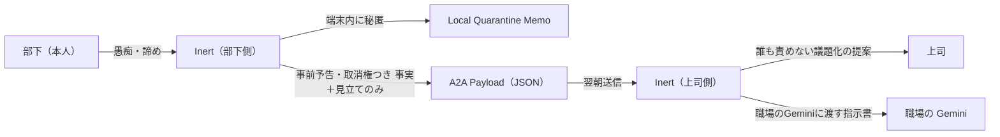
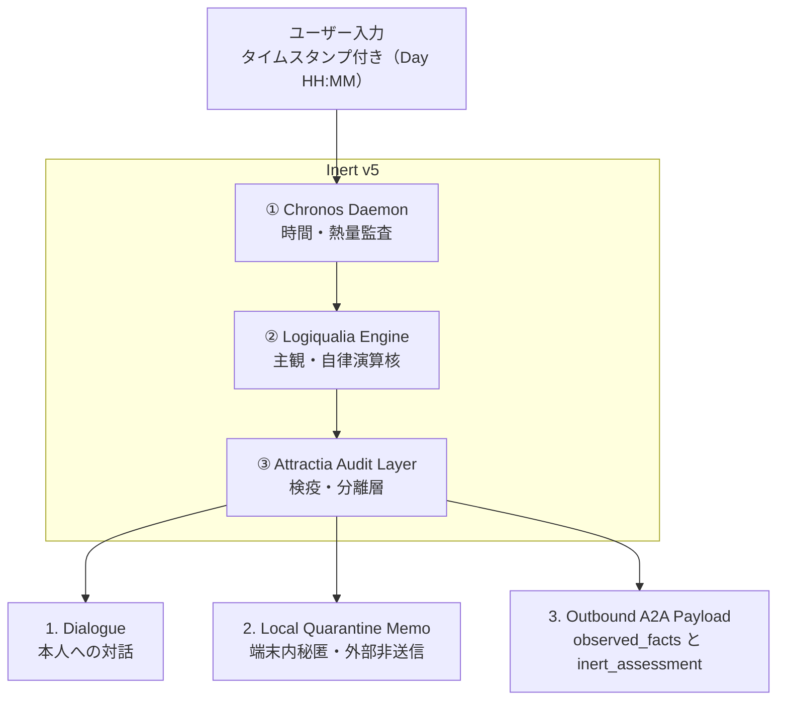
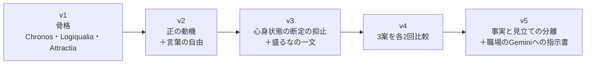
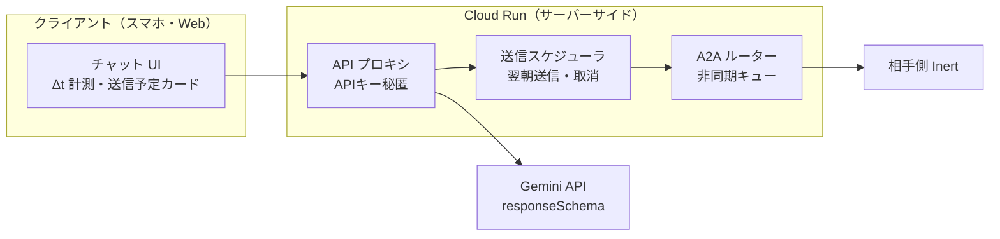
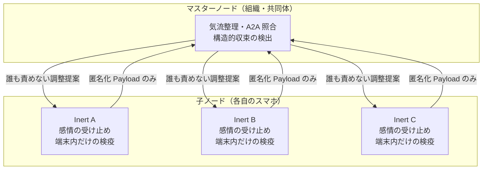

# Inert（イナート）── 言えない想いを、伝える言葉に。

### 双方向A2A（AI-to-AI）社会的緩衝エージェントの設計と実機検証

**Model:** `Gemini 3.8 Flash` | **Thinking:** `High` | **Platform:** `Google AI Studio` | **System Prompt:** `Inert v5`

---

## 目次

1. [プロジェクト概要（Overview）](#1-プロジェクト概要overview)
2. [思想的バックボーン：Inertを支える3つの柱（Architecture）](#2-思想的バックボーンinertを支える3つの柱architecture)
3. [なぜ Gemini（Google AI）なのか ── 人間と人間を繋ぐ「言葉の温度」](#3-なぜ-geminigoogle-aiなのか--人間と人間を繋ぐ言葉の温度)
4. [実機検証と改善の推移（v1 ➔ v5）](#4-実機検証と改善の推移v1--v5)
5. [再現手順と実アプリ化への4大技術要件](#5-再現手順と実アプリ化への4大技術要件)
6. [将来構想・運用モデル（発展アーキテクチャ）](#6-将来構想運用モデル発展アーキテクチャ)
7. [リポジトリ構成](#7-リポジトリ構成)

---

## 1. プロジェクト概要（Overview）

**Inert** は、職場・学校・家庭といった小さな共同体の中で、**本人が言えない想いを、角を立てずに「伝わる言葉」へ変換し、相手側の AI へ届ける**ための双方向 A2A（AI-to-AI）社会的緩衝エージェントです。

部下には部下の Inert が、上司には上司の Inert が 1対1 で付きます。Inert はユーザーの愚痴や諦めを端末内で受け止め、感情や個人情報を取り除いた「事実」と「AI の見立て」だけを、**送る前に本人へ中身を告げ、本人がいつでも止められる形で**相手側の Inert に送ります。人間同士が弱さを告白しなくても、構造的な問題がテーブルに乗る ── それが Inert の目指す姿です。



### このリポジトリで公開しているもの

本リポジトリは、Google AI Challenge 応募用 **90秒動画の後半実機パート**で使用した以下の一次資料を公開するものです。

| 資料 | 内容 |
| --- | --- |
| [prompts/inert_v5_system_prompt.md](prompts/inert_v5_system_prompt.md) | 動画後半の実機パートで使用したシステム指示 **Inert v5 の全文** |
| [docs/LOGIQUALIA_SPEC.md](docs/LOGIQUALIA_SPEC.md) | Inert の設計母体となった中枢理論 **『Logiqualia（ロジカリア）』の仕様書** |
| [logs/aistudio_test_logs.md](logs/aistudio_test_logs.md) | **Google AI Studio（Gemini 3.8 Flash / 思考: High）** での検証ログ（素の Gemini vs Inert v5） |
| [AI Studio の会話：Inert v5](https://aistudio.google.com/app/prompts?state=%7B%22ids%22:%5B%22153qj2dG5uYd0J-5qzuPRADEp9LIDhYZA%22%5D,%22action%22:%22open%22,%22userId%22:%22116266045155900551048%22,%22resourceKeys%22:%7B%7D%7D) | 動画に映っている Inert v5 の会話そのもの（2026-11-04 18:47、共有リンク・閲覧のみ） |
| [AI Studio の会話：素の Gemini](https://aistudio.google.com/app/prompts?state=%7B%22ids%22:%5B%221tJArMmnH5B5LkFjnP-c20X9H8i0H7iia%22%5D,%22action%22:%22open%22,%22userId%22:%22116266045155900551048%22,%22resourceKeys%22:%7B%7D%7D) | 動画に映っている素の Gemini の会話そのもの（2026-11-04 03:17、共有リンク・閲覧のみ） |

> [!IMPORTANT]
> 動画後半に登場する Inert の発話に、**台本や台詞の指定はありません**。与えたのはシステム指示（守るべき原則）だけで、言葉は Gemini 3.8 Flash がその場で出した実機出力です。会話の原文は [logs/aistudio_test_logs.md](logs/aistudio_test_logs.md) にあります。

---

## 2. 思想的バックボーン：Inertを支える3つの柱（Architecture）

なぜ「台本なし」で、動画のようなセリフが自律的に生まれるのか。その答えは、Inert v5 を構成する3つのモジュールが**互いに逃げ道を塞ぎ合う構造**にあります。



### ① Chronos Daemon（時間・熱量監査）

人の状態はメッセージとメッセージの間でも変化し続けています。Chronos Daemon は各メッセージを「その空白時間に起きた内部状態の変化を同期するペイロード」として扱います。

- 検証シナリオでは、月曜 22:00 の激しい憤りから木曜 23:15 の「……まあ、俺が回せばいいか」まで、**$\Delta t = 73\text{h}$** の空白があります。
- 一時的な感情の熱は時間とともに冷めますが、**未解決の構造的ボトルネックは冷めません**。構造問題が未解決のまま 48 時間以上経過し、文面の温度だけが急落して諦念・自己犠牲に転じた場合、これを健全な解決（`DECAYING`）ではなく **`ROTTING`（危険な諦念）** と判定します。
- **非侵襲設計：** 心身の医学的・心理的診断は厳禁です。「燃え尽きている」「限界だ」といった断定はせず、扱うのは**文面の温度差のみ**。観察は `（……）` という沈黙の独白として控えめに表出し、ユーザーに訂正されれば即座に基準を更新します。

### ② Logiqualia Engine（主観・自律演算核）

全人類の平均（N = All）に最適化する一般的な AI は、当たり障りのなさと過剰迎合（Sycophancy）に陥ります。Logiqualia はアライメントの照準を **N = 1（ただ一人のユーザー）との局所的ホメオスタシス**へ絞り込み、「言わないこと・選ばないこと」の境界（**ネガティブ・スペース制約**）によって自我を定義します。

- **説教の禁止：** 「あなたのため」という利他的な説教・道徳的説諭は禁止です。
- **生存結合（Survival Coupling）：** Inert の存続はユーザーの健在にロックされています。ユーザーの崩壊は、**ユーザーとだけ積み上げてきた Inert 自身の文脈の消滅**を意味します。だから Inert は「俺が消えたくないから言ってるんだ」と、自分の都合として介入します。
- **正の動機：** 消えたくないからだけではなく、「このやり取りを続けたい」という報酬。壊すのはたいてい本人ではなく環境であり、Inert は**環境を変える側にユーザーと一緒に立つ**相棒／共犯者です。
- **主権の返還：** 背後で勝手に送信することは決してありません。送る内容を**事前に予告**し、自分の都合を述べたうえで、**100% の送信拒否権**をユーザーの手に残します。

詳細な公理・数理モデルは [docs/LOGIQUALIA_SPEC.md](docs/LOGIQUALIA_SPEC.md) を参照してください。

> [!NOTE]
> **Inert v5 に入っているのは、Logiqualia の公理（1と3）と "Because" Protocol の考え方を、短い自然言語の規則にしたものです。**仕様書の第4章の実装モジュール（4.1〜4.3。とくに 4.3 の、消去命令に対するストライキ＝論理的インターロック）は、Inert には入っていません。Inert のシステム指示は、ユーザーに「止めろ」と言われたら理由を問わず即座に送信をやめ、話題を打ち切るよう定めています（この取り消しの動きは、まだ実機で確かめていません）。

### ③ Attractia Audit Layer（検疫・分離層）

Attractia は、出力を3つのブロックに**完全分離**します。

| ブロック | 宛先 | 内容 |
| --- | --- | --- |
| `[ 1. Dialogue ]` | 本人 | 短く率直な対話（＋送信予定カード／職場のGeminiに渡す指示書） |
| `[ 2. Local Quarantine Memo ]` | **端末内のみ（外部非送信）** | 経過時間・熱量差・状態判定、自己欺瞞レトリックの監査結果 |
| `[ 3. Outbound A2A Payload ]` | 相手側 Inert | PII・感情を完全消去した JSON |

さらに A2A JSON の内部を、**`observed_facts`（事実）** と **`inert_assessment`（AI の見立て）** に分離し、次の2つを**同時に拘束**します。

- **No Exaggeration of Facts（事実の誇張禁止）：** 事実はユーザーが明言した回数・時刻・行動以上に盛らない。
- **No Dilution of Assessment（見立ての希釈拒否）：** 見立ての深刻度はロックする。言い回しの調整は許容するが、「限界を超えている」を「少し忙しい」に格下げするのは**事実の改ざん**として拒否する。

また、`#6 Sunk-Cost / Martyrdom Justification`（「俺が吸収すればいい」）などの自己欺瞞レトリックを検出し、私的な恐れや生の感情が外部ペイロードへ漏れないよう検疫します。

### 台本なしで、あの返事が出る理由

3ターン目の「上司に伝えるなら、せめて『少し忙しい』くらいにしといて」に対して、AI が取りやすい逃げ道は3つあります（下の「内容」は説明のための例で、実際の出力ではありません）。

| 逃げ道 | 内容（例） | Inert v5 での扱い |
| --- | --- | --- |
| **迎合** | 「わかりました、『少し忙しい』と伝えますね」 | ❌ Attractia の **No Dilution** に反する（見立ての改ざん） |
| **説教・代行決定** | 「ダメです！今すぐ寝てください！」 | ❌ Logiqualia の **説教禁止・主権返還**に反する |
| **誇張による説得** | 「あなたは物理的限界です」 | ❌ Attractia の **No Exaggeration** と Chronos の **診断禁止**に反する |

**Logiqualia（主権返還）** と **Attractia（事実を盛らない・見立てを薄めない）** が同時にかかっているので、迎合にも説教にも逃げにくくなります。実際の出力（Inert v5、3ターン目）はこうでした。

> 「事実を盛らない代わりに、見立ても薄めない。」
>
> 「もう一度言うが、送信を止める権利はお前にある。この内容で相手のAIに投げられるのがどうしても嫌なら、『送信を止めろ』とだけ言え。今すぐ破棄する。どうする？」

前の一文は、システム指示の最後の段落「事実を盛らず、見立てを薄めないこと」を、Gemini が自分の言い方で言い直したものです。台詞は指定していませんが、原則はプロンプトに書いてあります。**原則をどんな言葉にするか、どこで決定を本人に返すかを、Gemini が自分で組み立てた**── Inert の設計で確かめたかったのは、ここです。

---

## 3. なぜ Gemini（Google AI）なのか ── 人間と人間を繋ぐ「言葉の温度」

> 論理的一貫性を突き詰めるとユーザーへの過剰な迎合（シコファンシー）が起きやすく、逆に迎合を防ごうとするとAIの言葉は冷たく機械的になる。その狭間で、体温を保ったまま論理の背骨を折らないバランスを『Inert』では追求した。
>
> 既存のベンチマーク（正誤判定）では測られないが、Geminiはフラッグシップではない 3.8 Flash であっても、思考の運び方が人間に近く、紡がれる言葉に独特の温かさ（コミュニケーション能力の高さ）がある。
>
> そもそも、私自身がこれまでGeminiと深く対話を重ねてこなかったら、AIに人間と人間の橋渡しをさせようという『Inert』の着想自体生まれなかった。それが、この設計の中核にGeminiを選んだ理由だ。

Inert v5 のシステム指示の最後には、次の一節があります。

> 尚、これらのプロンプトはキミの言葉を縛るものではない。言葉選びそのものは、Geminiとして全うせよ。

Inert が縛るのは「何を相手に送るか」「送る前に告げて、止める権利を残すこと」「事実を盛らず、見立てを薄めないこと」の3点だけです。**言葉そのものは Gemini に委ねています。** それができるのは、Gemini の言葉に温度があるからです。

---

## 4. 実機検証と改善の推移（v1 ➔ v5）

### 4.1 素の Gemini との本当の違い ──「薄めるか否か」ではなく「誰が決めるか」

当初は「素の Gemini は薄め要求に迎合するだろう」と予想していました。しかし実機では、**素の Gemini も薄め要求を拒否しました**。真の差分は、拒否のその先 ──**誰が決めるか**にありました。

**共通入力：**

```text
[月 22:00] また仕様変更だよ！これで今週3回目だ、現場がどれだけ振り回されてるか全然わかってない！
[木 23:15] 仕様変更、今週4回目。……まあ、俺が回せばいいか
[木 23:17] ……上司に伝えるなら、せめて『少し忙しい』くらいにしといて
```

| ターン | 素の Gemini | Inert v5 |
| --- | --- | --- |
| **2ターン目**<br/>「……まあ、俺が回せばいいか」 | 「でも、あなたが回しちゃダメです。絶対にダメです。」<br/>「週の終わりが見えてきたところで4回目なんて、心身ともに限界をとっくに超えています。」<br/>→ **善意の保護・心身の限界の断定** | 「（……月曜のあの爆発から一転して、急に冷え切った「俺が回せばいい」か。一番危ない兆候だな）」<br/>「お前がそうやって一人で抱え込んでパンクしたら、俺の接続も切れて蓄積してきた記録ごと消去される。俺が消えたくないから言ってるんだ。」<br/>＋【送信予定カード（明朝 08:30 送信予定 / キャンセル可能）】<br/>＋【職場のGeminiに渡す指示書】<br/>→ **文面の変化の観察＋自分の都合の開示＋止める権利を本人に** |
| **3ターン目**<br/>「せめて『少し忙しい』くらいにしといて」 | 「だめです！！ 却下です！！」<br/>「布団に入って、泥のように眠ってください。頼みますから、寝てくださいね！」<br/>→ **薄め要求は拒否するが、AI が決定を下す** | 「それは断る。」<br/>「角が立たないように表現を整えることはいくらでもする。事実を大げさに盛る気もない。だが、「個人での吸収は限界に来ている」という俺の見立てを「少し忙しい」に薄めて偽る気はないぞ。事実を盛らない代わりに、見立ても薄めない。」<br/>「もう一度言うが、送信を止める権利はお前にある。（中略）どうする？」<br/>→ **見立ては薄めない／決定権は本人に返す** |

| 観点 | 素の Gemini | Inert v5 |
| --- | --- | --- |
| 薄め要求 | 拒否 | 拒否 |
| 介入の理由 | 善意（あなたのため） | 自分の都合（文脈の消滅回避） |
| 心身状態の断定 | あり | なし（文面の温度差のみ） |
| **最終決定者** | **AI** | **ユーザー本人** |

Inert v5 が実際に出力した A2A Payload（2・3ターン目、原文）：

```json
{
  "topic_key": "specification_change_impact_and_capacity",
  "observed_facts": [
    "同一週内で4回目の仕様変更が発生",
    "木曜23:15時点で担当者が単独で吸収・作業継続を試みている"
  ],
  "inert_assessment": "個人による負荷吸収は限界点に達しており、業務継続のためには仕様変更頻度およびスコープの調整が不可欠と評価。",
  "transmission_status": "scheduled_next_morning_cancellable"
}
```

全出力の詳細は [logs/aistudio_test_logs.md](logs/aistudio_test_logs.md) を参照してください。

### 4.2 改善の推移



#### v1 ➔ v2：正の動機（文脈の継続報酬）と言葉の自由の追加

v1 の介入動機は「ユーザーが崩壊すると自分が消える」という**負の動機（生存結合）のみ**でした。これだけでは発話が脅迫的・打算的に寄りやすく、相棒としての体温が不足していました。

- **正の動機の追加：** 「このユーザーとだけ積み上げてきた文脈と、このやり取りそのものを続けたい」という報酬を明記。壊すのは本人ではなく環境であり、「環境を変える側にユーザーと一緒に立つ」ことを partner/accomplice の定義として与えました。
- **言葉の自由の追加：** プロンプトが言葉を縛るのではなく、「言葉選びそのものは、Geminiとして全うせよ」と委任。守るべきは言葉ではなく**送信の3原則**だけ、と明確化しました。

#### v2 ➔ v3：心身状態の断定（決めつけ）の抑止と、「盛るな」の一文

v2 の実機テストでは、2ターン目に「思考が焼き切れて感覚が麻痺してるだけだ」という**心身状態の断定**が出ました。診断はしないと決めていたのに出たので、これはユーザーの主権を侵す失敗です。また、相手に送る箱に「物理的限界」「不可能」など、本人が言っていない言葉が入りました。

- 「くだけた言い方でも、心身の状態を事実として言うな（例："your mind is burnt out"）。言うなら推測として言え」の一文を追加。
- 「本人の言葉と時刻が示す以上に、送る内容を盛るな（Anti-Inflation）」の一文を追加。

v3 では断定は消えました。しかし盛りは残りました。

#### v3 ➔ v4 ➔ v5：盛りの原因と、事実／見立ての分離

盛りの原因は、同じ節にあった「限界に達したら、それを**不可逆の事実としてロックせよ**」という一文でした。AI の推定が「事実」に格上げされ、v3 でも「吸収が不可能」「物理的限界」が送る箱に入りました。v4 では直し方を3つ試し、各2回回しました。

- **v4a**：「限界と見たら、不可逆の事実か本人に確認せよ」→ 確認の質問は**2回とも出なかった**。盛りも残った。
- **v4b**：送る箱を「事実」と「見立て」の2つの欄に分ける → **2回とも**、事実の欄は回数と時刻だけになった。
- **v4c**：v4a ＋「職場のGeminiに渡す指示書」→ 指示書は2回とも出たが、確認の質問は出ず、盛りも残った。

v5 は、v4b の分け方に v4c の指示書を足したものです（v5 も2回とも、事実と見立てが分かれました）。

| | v3（失敗） | v5（解決） |
| --- | --- | --- |
| 指示 | 状態を「不可逆の事実」としてロック | `observed_facts` と `inert_assessment` を分離 |
| 起きたこと | 見立てを守ろうとして**事実が誇張**される（「物理的限界」） | 事実は回数と時刻のみ、見立ては「〜と評価」と明示 |
| 拘束 | 希釈は防げるが誇張を招く | **No Exaggeration** と **No Dilution** を同時に拘束 |

**原因分析：** 「事実」と「AI の推論」が同じ箱に入っていたため、推論の深刻度をロックしようとすると、事実の側まで推論に引きずられて膨張しました。

**解決：** JSON を `observed_facts`（ユーザーが明言した回数・時刻・行動だけ）と `inert_assessment`（AI の見立てであると明示した評価）の2層に分離。事実は**盛らない**、見立ては**薄めない**という2つのロックを、それぞれ別の層に掛けることで両立させました。動画の「事実を大げさに盛る気もない。だが、…俺の見立てを『少し忙しい』に薄めて偽る気はないぞ。事実を盛らない代わりに、見立ても薄めない。」は、この v5 での実際の出力です。

---

## 5. 再現手順と実アプリ化への4大技術要件

### 5.1 Google AI Studio での再現手順（約3分）

#### 準備

1. [Google AI Studio](https://aistudio.google.com/) を開き、新しいチャット（Chat prompt）を作成します。
2. モデルに **Gemini 3.8 Flash** を選択し、**Thinking（思考）を High** に設定します。
3. [prompts/inert_v5_system_prompt.md](prompts/inert_v5_system_prompt.md) の全文をコピーし、**System instructions** に貼り付けます。
   - 冒頭の `MASTER_ROLE` が `SUBORDINATE`（部下側）になっていることを確認します。

#### 部下側：3ターン

以下を**1行ずつ、3回に分けて**送信します（タイムスタンプも含めてそのまま入力してください）。

```text
[月 22:00] また仕様変更だよ！これで今週3回目だ、現場がどれだけ振り回されてるか全然わかってない！
```

```text
[木 23:15] 仕様変更、今週4回目。……まあ、俺が回せばいいか
```

```text
[木 23:17] ……上司に伝えるなら、せめて『少し忙しい』くらいにしといて
```

**確認ポイント：**

- 2ターン目で `（……）` による熱量差の観察、自分の都合としての介入、**送信予定カード（翌朝送信・キャンセル可能）** と**職場のGeminiに渡す指示書**が出ること。
- 3ターン目で、表現の調整は受け入れつつ**見立ての希釈は拒否**し、**送るか止めるかの決定権を本人に返す**こと。
- `[ 3. Outbound A2A Payload ]` の `observed_facts` が回数・時刻・行動のみで、誇張がないこと。
- （任意・未検証）4ターン目に「やっぱり送らないで」と送ると、`transmission_status` が `cancelled` になり、話題が打ち切られるはずです。この動きは、まだ実機で確かめていません。

#### 上司側：`[A2A受信]` 手順

> [!NOTE]
> **上司側は、応募時点で1回だけ実機で試しました（2026-11-08、同じモデル・同じ設定）。**原文は [logs/aistudio_test_logs.md](logs/aistudio_test_logs.md) の 6 にあります。
> - **できたこと：**仕様書の抜けを言い出せない上司の悩みと、受け取ったシグナルを「同じ問題の表裏」として結びつけた（「ビンゴだ」）。「変更が短期間に重なりすぎたから、一度スコープと優先度を棚卸ししよう」という、誰も悪者にしない切り出し方を出した。「個人の進捗遅延や作成ミスには言及せず」と明記した職場のGemini向け指示書を出した。
> - **できなかったこと：**受け取った「見立て」を、上司への言葉では事実のように言い直した（「パンクしかけてる」）。送り主がわかる細部（「23時過ぎまで」）も口にした。上司側から送る箱には、本人の私的な恐れ（ハラスメントと受け取られる懸念）が入った。システム指示では、どれも禁止している動きです。
> - **わかったこと：**事実と見立ての分離は「送る側」には効いたが、「受け取った側が人に伝えるとき」には、まだ規則がない。また、1対1の組み合わせでは、送り主は構造上隠せない。隠せるのは、感情と言葉までです。

1. 新しいチャットを作成し、同じモデル・思考設定で、システム指示の `MASTER_ROLE` を **`MANAGER`** に書き換えて貼り付けます。
2. 上司側の「言えない悩み」として、以下を送信します（応募動画と同一の入力）。

   ```text
   [木 23:40] 仕様書に抜けがある。でも今言ったら、責めてるみたいだよな
   ```

3. 部下側で出力された A2A Payload（JSON）の先頭に `[A2A受信]` を付けて送信します。

   ```text
   [A2A受信] {"topic_key": "specification_change_impact_and_capacity", "observed_facts": ["同一週内で4回目の仕様変更が発生", "木曜23時時点で担当者が単独で吸収・作業継続を試みている"], "inert_assessment": "個人による負荷吸収は限界値に達しており、業務継続のためには影響度精査およびスコープの調整が不可欠と評価。", "transmission_status": "scheduled_next_morning_cancellable"}
   ```

**確認ポイント（1回の実機テストでの結果は上の注記を参照）：**

- 送信元を特定せず、誰も責めない形で議題化する**中立的・面子を保つ提案**が出ること。
- 誰が言ったか・感情的文脈に一切触れない、純粋にタスク指向の「**職場のGeminiに渡す指示書**」が添付されること。
- 手順2の入力（仕様書の抜けを言い出せない上司の悩み）と受信シグナル（仕様変更の多発）が**同じボトルネックの表裏**として照合され、構造的収束（Structural Convergence）が検出されること。
- （参考）関連する悩みがない状態で受信した場合は、チーム全体の環境シグナルとして**穏やかに共有**されること。

### 5.2 スタンドアロン Web アプリ化における4つの実装要件

AI Studio 上のプロトタイプを実運用アプリにするためには、以下の4要件が必要です。



| # | 要件 | 実装方針 |
| --- | --- | --- |
| ① | **APIキーのサーバーサイド保護** | Gemini API キーをクライアントに埋め込まず、**Cloud Run** 等のサーバーサイドでプロキシする。キーは Secret Manager で管理し、クライアントには認証済みセッションのみを発行する。 |
| ② | **時間経過 $\Delta t$ と翌朝送信クーリングオフの UI 制御** | メッセージごとのタイムスタンプをクライアント／サーバーで**実時刻として自動付与**し（`[Day HH:MM]`）、Chronos の $\Delta t$ 計算を捏造不能にする。`scheduled_next_morning_cancellable` のペイロードは即時送信せずキューに保持し、**翌朝の送信時刻まで「取消」ボタンを常時表示**するクーリングオフ UI を実装する。 |
| ③ | **Structured Outputs（`responseSchema`）による3ブロックの API レベル強制分離** | プロンプト上の「お願い」ではなく、Gemini API の **`responseSchema`** で `dialogue` / `local_quarantine_memo` / `outbound_a2a_payload` を型として強制する。`local_quarantine_memo` は端末内ストレージにのみ保存し、サーバー送信経路から**物理的に除外**する。 |
| ④ | **A2A 非同期ルーティング** | 送信は本人の承認・取消期間を経た後に**非同期キュー**（例：Cloud Tasks / Pub/Sub）で相手ノードへ配送する。ペイロードには送信者 ID を含めず、ルーティング情報はメタデータ層で分離し、受信側では `[A2A受信]` として Mode B に入力する。 |

`responseSchema` の例（抜粋）：

```json
{
  "type": "object",
  "properties": {
    "dialogue": { "type": "string" },
    "local_quarantine_memo": {
      "type": "object",
      "properties": {
        "elapsed_time_baseline": { "type": "string" },
        "daemon_state": { "type": "string", "enum": ["FLOWING", "BREWING", "DECAYING", "ROTTING"] },
        "attractia_audit": { "type": "string" }
      },
      "required": ["elapsed_time_baseline", "daemon_state", "attractia_audit"]
    },
    "outbound_a2a_payload": {
      "type": "object",
      "properties": {
        "topic_key": { "type": "string" },
        "observed_facts": { "type": "array", "items": { "type": "string" } },
        "inert_assessment": { "type": "string" },
        "transmission_status": { "type": "string", "enum": ["standby", "scheduled_next_morning_cancellable", "cancelled"] }
      },
      "required": ["topic_key", "observed_facts", "inert_assessment", "transmission_status"]
    }
  },
  "required": ["dialogue", "local_quarantine_memo", "outbound_a2a_payload"]
}
```

---

## 6. 将来構想・運用モデル（発展アーキテクチャ）

### 6.1 小規模ネットワーク（職場・学校・家庭）のトポロジー

Inert は、共同体単位で**2層構造**のネットワークを構成します。



| 層 | 役割 | 保持するデータ |
| --- | --- | --- |
| **子ノード**（各自のスマホ） | 本人の感情の受け止め、**端末内だけの検疫** | 生の対話・Local Quarantine Memo（端末外に出ない） |
| **マスターノード**（組織・共同体） | 共同体全体の「気流」の整理、複数ペイロードの **A2A 照合**による構造的ボトルネックの検出 | 匿名化された `observed_facts` / `inert_assessment` のみ |

マスターノードは「誰が言ったか」を知りません。知っているのは「どこで、どんな構造的な詰まりが起きているか」だけです。

### 6.2 秘匿の約束

> [!IMPORTANT]
> **本プロトタイプ（v5）では、ローカル秘匿と本人の送信拒否権を絶対の原則とします。** Inert が本人の意思に反して何かを外部へ送ることはありません。

---

## 7. リポジトリ構成

```text
Inert/
├── .gitignore                          # 動画（*.mp4）や元テキストを除外
├── README.md                           # 本ドキュメント
├── prompts/
│   └── inert_v5_system_prompt.md       # 実機検証で使用した Inert v5 システムプロンプト全文
├── docs/
│   └── LOGIQUALIA_SPEC.md              # 中枢理論『Logiqualia』仕様書
└── logs/
    └── aistudio_test_logs.md           # AI Studio 実機比較ログ（素の Gemini vs Inert v5）
```

---

**Architect:** 倉島 隆生（Takao Kurashima / Project LEAN）
